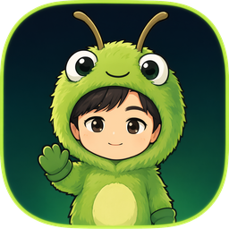
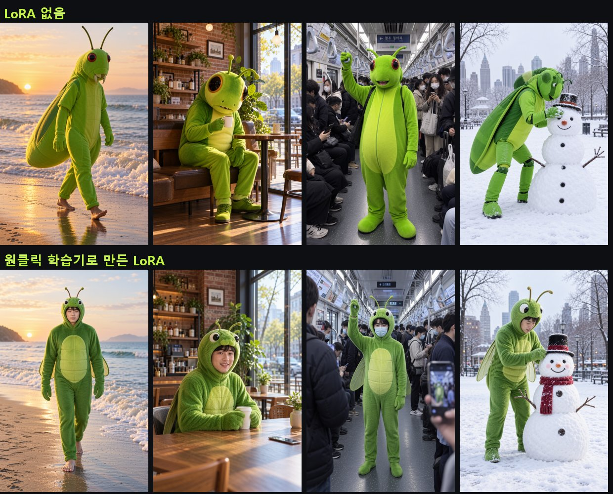
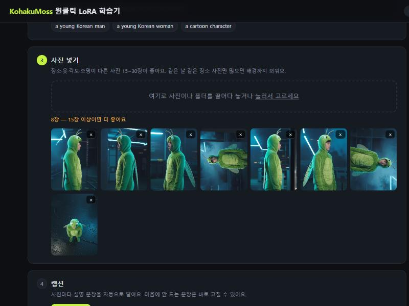
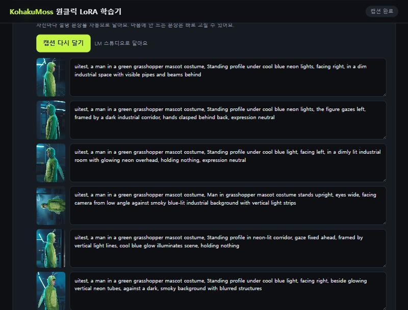
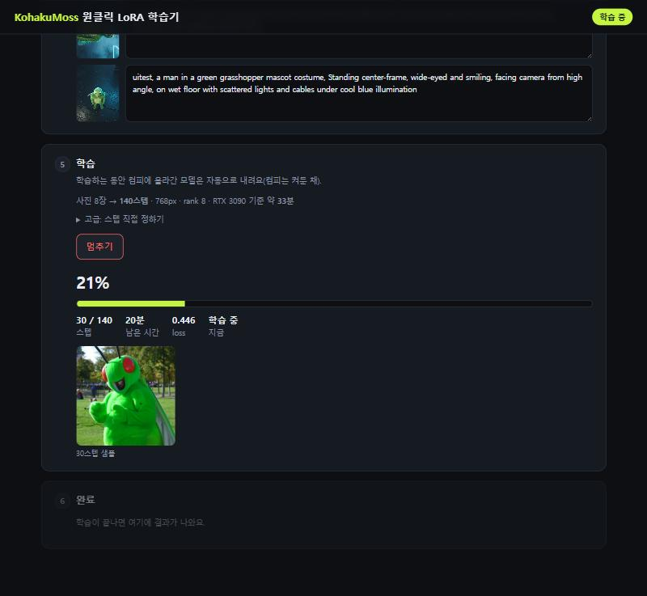

<p align="center"></p>

# KohakuMoss 원클릭 LoRA 학습기

**MOSS-Image**에 내 얼굴·캐릭터·의상을 가르치는 LoRA를, 브라우저 화면에서 클릭 몇 번으로 만듭니다.
사진 넣기 → 캡션 자동 작성·수정 → 학습 → ComfyUI LoRA 목록 등록까지 한 번에 진행돼요.

학습 엔진은 [KohakuMossTrainer](https://github.com/KohakuBlueleaf/KohakuMossTrainer)(KohakuBlueLeaf)이고,
이 저장소는 그걸 쉽게 쓰게 해 주는 실행기입니다. KohakuMossTrainer를 먼저 설치해야 해요.



## 준비물

- **KohakuMossTrainer**: `C:\KohakuMossTrainer`에 설치 (설치 영상: 너무바쁜베짱이 유튜브)
- **ComfyUI**: models 폴더만 있으면 됩니다
- **NVIDIA 그래픽카드**: RTX 3090 24GB에서 테스트했어요
- **Git**: KohakuMossTrainer 설치할 때 이미 깔았을 거예요

## 설치

PowerShell에서 한 줄씩:

```powershell
cd C:\
git clone https://github.com/nicekriss/KohakuMoss-OneClick
```

업데이트는 `C:\KohakuMoss-OneClick` 폴더에서 `git pull` 한 번이면 됩니다.

## 쓰는 법

`KohakuMoss_원클릭학습.bat`을 더블클릭하면 브라우저에 학습기 화면이 열려요.
검은 창은 학습기 본체라서, 닫으면 학습기가 꺼집니다.
`바로가기_만들기.bat`을 한 번 실행하면 바탕화면에 베짱이 아이콘 바로가기가 생겨요.

| 단계 | 하는 일 |
|---|---|
| 1 준비 | 처음 한 번만 ComfyUI의 `models` 폴더 경로를 넣어요. MOSS 모델 3개가 없으면 **없는 모델 받기** 버튼으로 받아요(합쳐서 약 12GB). |
| 2 정보 | 트리거 단어, 종류(사람 / 캐릭터·의상 / 얼굴), 짧은 설명. 설명은 **한글로 써도** 캡션 단계에서 영어로 옮겨요. |
| 3 사진 | 사진이나 폴더를 끌어다 놓아요. 빼고 싶은 사진은 × 로. |
| 4 캡션 | **캡션 달기** → 문장이 마음에 안 들면 그 자리에서 고쳐요. |
| 5 학습 | **학습 세기**(가볍게 / 기본 / 진하게)를 고르고 시작. 스텝은 사진 수에 맞춰 자동이에요. 진행률·남은 시간·중간 샘플이 화면에 보여요. |
| 6 완료 | ComfyUI LoRA 목록의 `MOSS\<트리거>.safetensors`로 들어가요. 폴더 열기 버튼과 스텝별 비교 이미지가 나와요. |

<p>
  
</p>

창을 닫았다가 다시 열어도 마지막 작업(트리거·사진·캡션)이 그대로 남아 있어요.

## 캡션

- LM Studio 서버가 켜져 있고 비전 모델(qwen3-vl 등)이 있으면 그걸 쓰고, 끝나면 모델을 내려 둬요.
- 없으면 내장 **Qwen3-VL-2B**로 달아요. 처음 한 번 약 4GB를 받아요.
- 캐릭터·의상 모드는 캡션에 섞인 의상 설명을 자동으로 빼서, 의상이 트리거 단어에 붙게 해요.

## 사진과 시간

- **사람·캐릭터**: 장소·옷·각도·조명이 다른 사진 15~30장. 같은 날 같은 장소 사진만 많으면 배경까지 외워요.
- **얼굴(디테일러용)**: 얼굴만 잘라 둔 사진 30~50장. 자동으로 자르지는 않아요.
- **시간(RTX 3090, 기본 세기)**: 사람·캐릭터 30분~1시간, 얼굴 1시간 안팎. 첫 실행은 준비에 몇 분 더 걸려요.
- 사람·캐릭터는 768px·rank 8로 학습해요. 1024px·rank 32와 같은 장면에서 비교했을 때 품질 차이가 안 보이면서 학습 시간은 절반 이하, 파일은 47MB예요.
- 학습 중에는 ComfyUI에 올라간 모델을 자동으로 내려요(ComfyUI는 켜둔 채). 다른 생성 작업을 같이 돌리면 느려져요.

## 결과 쓰기

- ComfyUI에서 LoRA를 걸고 프롬프트에 트리거 단어를 넣으세요.
- 프롬프트가 잘 안 먹으면 LoRA 세기를 0.6~0.8로 낮춰 보세요.
- 배경·옷까지 너무 따라 나오면 중간 저장본(`<트리거>-스텝수.safetensors`, 숫자가 작을수록 가벼움)을 쓰거나 다음엔 **가볍게**로 돌리세요.

## 문제가 생기면

- **KohakuMossTrainer was not found**: 다른 곳에 설치했다면 이 폴더에 `kohaku_path.txt`를 만들고 그 경로를 한 줄로 적으세요.
- **모델이 하위 폴더에 있어요**: 괜찮아요. 하위 폴더에 있으면 `models\_kohakumoss_weights`에 하드링크(추가 용량 없음)를 만들어 써요. 다른 드라이브면 모델을 `diffusion_models` 바로 아래로 옮겨 주세요.
- 작업 기록은 `runs\<트리거>\log.txt`에 남아요.

명령창으로 쓰고 싶다면:

```powershell
C:\KohakuMossTrainer\.venv\Scripts\python.exe oneclick.py <사진폴더> --trigger 이름 --mode 2 --cls "설명"
```

## 라이선스

이 저장소의 코드는 [MIT](LICENSE)입니다. 학습 엔진 KohakuMossTrainer는 KohakuMoss License(Apache-2.0 + 이름 조항)를 따르고,
MOSS-Image 모델과 Qwen3-VL 모델은 각자의 라이선스를 따릅니다.

만든 사람: 너무바쁜베짱이 ([@toobusyAI](https://www.youtube.com/@toobusyAI))
